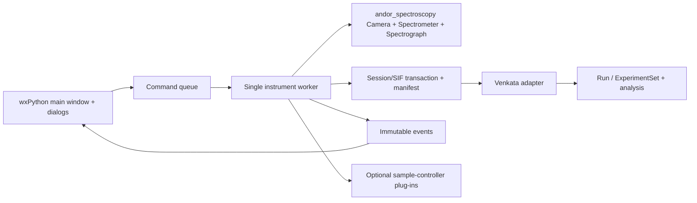

# Krishnan — Raman measurement GUI design

**Status:** design baseline, with first implementation pass described in [IMPLEMENTATION.md](IMPLEMENTATION.md), 12 October 2026  
**First release:** Windows x64; Andor SDK2 camera `DU401_BVF` (1024 × 127, 26 µm pixels) and Shamrock SR750-A  
**Relationship to Venkata:** separate acquisition application; shared `Run` and `ExperimentSet` data model and reusable analysis functions  
**Source of the interface concept:** the supplied hand sketch and the operator's request. The sketch describes desired controls and layout; it is not a hardware capability record.

## 1. Goal and scope

Krishnan is a Solis-inspired desktop workstation for collecting Raman spectra while preserving raw camera data and opening the results in Venkata. An operator should be able to inspect the current calibrated CCD span, preview a signal, capture a single spectrum, run a resumable sequence, or collect a wider spectrum by moving the spectrograph through overlapping single captures. The window also exposes CCD and installed spectrograph settings and gives immediate plotting and limited analysis.

The first release is a **native Windows wxPython application** with Matplotlib plots. It uses the existing [`andor_spectroscopy`](../andor-spectroscopy/README.md) package as its only device-control layer. Krishnan must not load the historical vendor Python wrappers directly or duplicate SDK `ctypes` bindings in GUI code. Native instruments and Solis cannot own the same devices simultaneously. Simulation is selected explicitly; a native connection failure is an error, never an implicit switch to simulation.

The application should remain useful for review of previously recorded sessions with no devices connected. External sample temperature, magnetic field, and rotation control are interface and plug-in contracts in this release; their controls stay disabled until their actual models, connection methods, limits, and safe stop behavior are supplied.

### Definition of release one

| Included | Boundary |
| --- | --- |
| Live preview; single FVB/track/image acquisition; sequence and angular batches; one-grating step-and-glue scan | No claim of Solis file or user-interface identity; use familiar workflow, not copied assets |
| Native SIF per saved physical acquisition; optional two-column TXT; Venkata CSV/HDF5 | No fabricated SIF for stitched data or simulator output |
| Capability-aware CCD and spectrograph panels | No guessed accessory controls, automatic cooler action, EEPROM edits, or automatic zero-order movement |
| Wavelength and, with a valid laser wavelength, Raman-shift display | No claim of absolute spectral accuracy until a line standard is measured |
| Cosmic-ray review and valid angular-map analysis using Venkata algorithms | No silent replacement of raw counts with corrected data |

The existing wrapper has already verified read-only identity, calibration parity, and several dark acquisition modes on the first target. Its [validation record](../andor-spectroscopy/VALIDATION.md) does **not** validate grating movement, a reference spectral line, cooling behavior, or every trigger/readout combination. The camera's reported `DU401_BVF` identity is the first-release target; an iDus 420 is a later acceptance target, not an assumed alias.

## 2. Operator workflow and window

```text
┌──────────────────────────────────────────────────────────────────────────────┐
│ Connection · Session/Sample · Live · Single · Batch · Stop · Snapshot · Export│
├─────────────────────────────────────────────────────┬────────────────────────┤
│ Spectrum                                            │ Batch/scan             │
│ overlays • zoom • cursors • nm/cm⁻¹                 │ progress and step list │
│ current CCD span and draggable target center        │ heatmap when valid     │
│                                                     │ latest status/error    │
├─────────────────────────────────────────────────────┴────────────────────────┤
│ Acquisition: exposure · cycle · accumulations · readout · Advanced…          │
│ Spectrograph: grating · center · slit/filter/ports only if installed         │
│ CCD: temperature · cooler · speed/gain · trigger · shutter                   │
│ Session: sample · laser nm · polarization · output folder · notes            │
└──────────────────────────────────────────────────────────────────────────────┘
```

Use a single `wx.Frame` with a top toolbar, a central `FigureCanvasWxAgg`, a right-hand notebook for **Steps**, **Map**, and **Details**, and collapsible bottom panels. Keep a visible state badge and last error. Matplotlib canvas and all wx widgets stay on the main thread. Instrument commands, file writes, SIF readback, and batch steps run on one device worker. Events from the worker carry immutable measurement/status objects; GUI updates use `wx.CallAfter`. Redraw at a bounded rate (for example 10 Hz) without dropping any frames that an explicitly recorded mode promises to retain.

### Toolbar and state-dependent behavior

| State | Enabled actions | Meaning |
| --- | --- | --- |
| `DISCONNECTED` | Connect, Open Session, Review/Export | No native handle owned. |
| `CONNECTING` | Cancel if supported | Enumerate and open the chosen camera and spectrograph; inventory capabilities; show each step. |
| `IDLE` | Live, Single, Batch, settings, disconnect, export | No acquisition is running. Optical moves and explicit cooler/shutter actions are allowed after validation. |
| `LIVE` | Stop, Capture Snapshot, display settings that do not reconfigure acquisition | Preview is unsaved. Snapshot first closes the stream, confirms idle, then performs a new saved single capture. |
| `ACQUIRING` | Stop | A single, batch step, or scan tile is in flight. Controls that change configuration are locked. |
| `STOPPING` | status only | Abort/request stop, wait for native idle, flush a completed shot, record interrupted step. |
| `FAULT` | Disconnect, diagnostics, review/export | No more acquisition until state and device ownership are reconciled. |

The active session and output folder are chosen before a saved acquisition. Leaving a session with unsaved derived analysis prompts for a decision; live preview alone does not count as saved data. Closing the application follows the site's camera cooling/shutdown procedure: Krishnan does not turn the cooler off or alter `SetCoolerMode` on its own.

### Live preview

Controls: exposure (seconds), requested repetition period (seconds), readout, and display range. Display both **requested** and **SDK-applied** exposure/kinetic cycle time; do not imply that a requested cycle shorter than readout time was achieved. Use wrapper `AcquisitionMode.CONTINUOUS`, `Spectrometer.stream`, bounded queue, and `loss_policy="preview"`; show retrieved/delivered/lost counts and whether loss came from the camera buffer or GUI queue. Frame saturation is a warning only when the camera's valid count range is known; otherwise show a maximum-count readout without an invented threshold. A raw preview frame is not saved. **Capture Snapshot** stops preview and creates a separately acquired single SIF.

For a future lossless continuous recording feature, switch to `loss_policy="strict"`, write every frame, and stop with an explicit data-loss error. A plot refresh may skip visual updates, but a recording pipeline must not skip data.

### Single capture

Choose name, exposure, accumulations, and a supported FVB, single/multi/random track, or image readout. For accumulations, use `AcquisitionMode.ACCUMULATE`; a plain single uses `SINGLE`. Validate ROI and binning against the actual detector dimensions, and resolve the selected trigger/readout speed/gain against queried capabilities. Display the acquired data immediately but mark the item **pending** until its raw SIF and manifest record pass readback. The saved SIF must finish before the next camera shot. For image data, show an image tab and a selectable row/region projection; do not silently flatten the entire image into a spectrum.

### Advanced acquisition dialog

One compact modal dialog exposes trigger mode, AD channel/amplifier, horizontal and vertical speeds, preamp gain, ROI and binning, and track parameters. Populate available choices from `Camera.capabilities()` and check trigger availability with `Camera.trigger_available()` after relevant settings. Show SDK index **and** physical speed/gain value. Unsupported combinations are disabled and accompanied by the SDK reason if available. Preview an expected array shape and validate before accepting. Keep cooler and shutter actions outside this dialog because they change device state independently of an acquisition configuration. SDK2 controls and timing readback are described in the [SDK2 manual](https://andor.oxinst.com/downloads/uploads/Andor_Software_Development_Kit_2.pdf).

## 3. Instrument panels

### Wavelength and spectrograph

The main plot shades the current CCD wavelength span from the spectrograph's **full-detector** calibration, with the center setpoint marker. Dragging the marker proposes a new center; it does not move the motor until the operator applies it. The target must be within `wavelength_limits(grating)` and must be checked again immediately before movement. Show commanded position, measured position, grating, motion activity, and the axis calibration's optical snapshot. `Spectrometer.set_wavelength` and `.set_grating` are the only Krishnan motor paths. Since the current native setter is synchronous, show a busy state and do not claim cancellable movement unless the SDK/backend can prove it.

Discover gratings through `gratings()`. Query the slit, shutter, filter, and flipper presence methods separately and show readback only for present devices. The recorded SR750-A inventory found **no** controllable motorized slit, spectrograph shutter, filter wheel, or flipper. On that installation those rows should say “Not installed / manual inspection required,” not render working sliders. A manual slit or optical path note may be recorded in session metadata without pretending to control it.

At connection, compare `calibration_geometry()` with `camera.detector[0]` and `camera.pixel_pitch_um[0]`. The observed ATSpectrograph session started with 0 pixels/0 pitch; a GUI **Configure calibration geometry** action calls `configure_calibration_geometry` and verifies readback. This changes working SDK inputs, not motor position or EEPROM. Captures requiring calibrated nm axes are blocked until geometry matches. `GetCalibration` must be read again after a grating, wavelength, or relevant port change. For ROI/horizontal binning, map physical columns first and average full-detector wavelengths for each output bin, matching [`Spectrometer`](../andor-spectroscopy/src/andor_spectroscopy/instrument.py).

### CCD and temperature

Show camera serial/head model, detector dimensions, reported temperature and status, setpoint range, cooler state, exposure/cycle readback, shutter mode, and readout/gain selections. A setpoint edit, cooler toggle, or shutter command is an explicit Apply action with resulting readback. Opening Krishnan or connecting does not change any of them. Read temperature status as a state, not just a numeric value; `wait_for_temperature` needs a finite timeout. The [iDus 401/420 guide](https://andor.oxinst.com/downloads/uploads/iDus%20Manual%20%28401%20and%20420%20series%29.pdf) distinguishes signal and dark shutter behavior; expose labeled modes only after confirming the attached camera's actual shutter mechanism and site practice. Hardware acceptance must establish the correct local cooler/shutdown procedure before those controls are enabled for routine use.

## 4. Batch acquisition and step-and-glue

The **Batch** editor contains a table of steps with order, index, display label, filename stem, scan coordinates, grating/center wavelength, exposure, requested cycle, accumulations, readout, and optional controller setpoints. A wizard can generate repeated singles, wavelength lists, grating lists, angular points, or a step-and-glue sequence. The right side previews the exact ordered steps, predicted duration, resulting file paths, and any collisions. The duration is an estimate based on SDK-applied cycle timings plus measured or conservative motion/stabilization overhead; never present it as a deadline.

Each step moves through `planned → configuring → moving → stabilizing → acquiring → saving → verifying → complete`, or `failed`/`interrupted`. A per-step manifest entry records requested values, applied readbacks, start/end times, raw path, checksums, status, and failure reason. A stop marks the current incomplete step and keeps prior complete steps. Resume verifies the manifest and every completed file, reacquires only incomplete/failed steps after operator selection, and never overwrites an existing raw file. Filename stems use a sanitized sample prefix, zero-padded step index, and durable step UUID; collision preflight occurs before starting. A raw file write uses a temporary sibling and atomic publish. On failure after exposure but before verified SIF publication, the step remains incomplete, and the worker does not issue another exposure until its SIF status is resolved.

### Step and Glue algorithm

1. Require one grating, a requested minimum/maximum wavelength in nm, valid calibration geometry, a supported single/accumulated spectral readout, an output folder, and an overlap fraction (default **10%**, editable with a safe positive bound).
2. At candidate grating centers within SDK limits, compute the calibrated CCD edge wavelengths. Plan a minimal monotonic series whose **usable** spans cover the requested interval with at least the chosen overlap. Show the planned centers, expected spans, count, and uncovered intervals before Start. Recalculate after each move from the actual readback axis; fail or replan explicitly if the promised overlap cannot be achieved.
3. Move with the wrapper, verify actual center/grating, take one single capture per tile, and save/verify its own raw SIF and calibration record. Do not mix gratings within one stitched product in release one.
4. Sort each tile by wavelength (detector axis can descend). Keep raw counts and raw wavelength arrays. Trim only to the requested final interval; never discard the source tiles.
5. Build a common monotonic wavelength grid at a resolution no finer than the best justified source spacing. Interpolate the two neighboring calibrated tiles in their overlap and blend with weights that vary linearly from one tile to the next. Outside overlaps, copy the contributing tile. Record interpolation grid, overlap, weights, tile IDs, and any gaps in processing history. Do not normalize away intensity differences without an explicit named correction.
6. Save the stitched result as derived two-column TXT and a Venkata run; link each point/region to its source tile IDs. The composite is **not** camera-generated SIF.

Andor describes Step and Glue as overlapping **single scans** with a linearly varying scaled average in the overlap, in the [Shamrock 500i/750 guide](https://andor.oxinst.com/downloads/uploads/Andor_Shamrock-500-750_Manual.pdf). Scan planning must also account for wavelength-dependent span and optical motion; a fixed nominal center increment is insufficient. A request beyond reachable grating limits is rejected before movement.

## 5. Data model and storage

### Save transaction

Native SIF is the fixed default for **every physical single, batch step, and wide-scan tile**. The existing wrapper currently reads SIF but does not write it. Add a coordinated `capture_and_save_sif` operation in `andor_spectroscopy`, not in the GUI. It must hold one camera/spectrograph acquisition transaction through capture and the SDK2 save call, so no subsequent shot can replace SDK2's “last acquisition.” Bind `SaveAsSif` and `SaveAsCalibratedSif` with the exact signatures from the bundled [`ATMCD32D.H`](../Andor%20SDK/ATMCD32D.H). Add a binding/read for `ShamrockGetPixelCalibrationCoefficients` or `ATSpectrographGetPixelCalibrationCoefficients`, as appropriate, and verify coefficients against the full-detector `GetCalibration` array before using calibrated SIF. Apply ROI/bin transformations correctly; if coefficients cannot truthfully represent the saved geometry, use native SIF plus a clearly named nm-axis sidecar instead.

When coefficients and laser wavelength are valid, prefer calibrated SIF with wavelength as the stored x unit. Keep Raman shift as a display/export transform rather than replacing the nm axis. Otherwise write native SIF and an axis/calibration sidecar with a visible “native SIF + sidecar” badge. Use a temporary SIF path, read it with [`SIFReader`](../andor-spectroscopy/src/andor_spectroscopy/sif.py), compare frame count, dimensions, and pixel values with the captured measurement (accounting for SIF `float32` conversion), then publish the final file and mark the step complete. The [SDK2 manual](https://andor.oxinst.com/downloads/uploads/Andor_Software_Development_Kit_2.pdf) documents the last-acquisition save methods. A save/readback failure is an acquisition failure, not a successful capture with a missing file.

In simulation there is no vendor SDK SIF writer and synthetic data must **not** be labeled native SIF. Save simulated raw frames with the wrapper's versioned NPZ format and identify them as `simulation` in the manifest and UI. The same batch/resume/export flow can operate on NPZ. Native hardware sessions must enforce SIF, with no automatic NPZ downgrade if SIF save fails.

Optional TXT is UTF-8, two tab-separated columns with a header: `Wavelength (nm)` and `Intensity (count)` for raw spectral exports, or `Raman Shift (cm-1)` only when a laser wavelength is set. Plot/export makes the selected axis and processing status explicit. The raw 1D camera counts remain associated with their original nm axis; no baseline, cosmic-ray, or normalization operation overwrites them.

### Session manifest

Store a versioned `session.json` in a unique session directory, updated atomically after each meaningful state transition. Use relative paths within the session directory plus checksums to make a moved session verifiable. Suggested layout:

```text
session-name/
  session.json
  raw/0001_<step-id>.sif
  raw/0002_<step-id>.sif
  calibration/0001_<step-id>.json
  derived/stitched-spectrum.txt
  exports/selected-runs.csv  (one CSV per selected run in practice)
  exports/experiment.h5
```

The schema needs `schema_version`, session UUID and creation time, sample and freeform notes, excitation/laser wavelength in nm, polarization, controller identities, camera/spectrograph serials and backend, SDK/library versions, detector geometry, cooler/temperature observation, optical settings, requested and applied acquisition settings, ordered step records, raw/derived paths, calibration provenance, processing history, and interrupted/failed steps. Include host receipt times while labeling them as host times, not hardware exposure timestamps. Preserve unsupported or unknown settings as `null` with explanation rather than manufacturing values.

An abbreviated step record illustrates the required distinctions:

```json
{
  "step_id": "8f7d...",
  "index": 1,
  "state": "complete",
  "requested": {"exposure_s": 0.01, "cycle_s": 0.05, "grating": 1, "center_nm": 532.0},
  "applied": {"exposure_s": 0.01324, "cycle_s": 0.05, "center_nm": 531.998},
  "raw": {"path": "raw/0001_8f7d.sif", "format": "native-sif", "sha256": "..."},
  "calibration": {"unit": "nm", "source": "spectrograph-sdk", "sidecar": null},
  "failure": null
}
```

The numeric values above are illustrative, not a promise of actual applied timing or motor precision. Validate loaded manifests with an explicit schema and reject unknown major versions for resume while allowing read-only inspection.

### Venkata adapter

Keep an adapter module independent of wx. A spectral capture becomes [`Run`](../data_structure.py) with `run_type=RunType.RUN_1D`, `wl_nm`, 1D `intensity`, `intensity_unit="count"`, a stable ID, raw `source_path`, and metadata containing sample, laser, polarization, settings, provenance, and links to raw SIF/sidecar. Compute `shift_cm1 = 1e7 × (1/laser_nm − 1/wl_nm)` only if `laser_nm` is finite and positive and all wavelengths are valid; retain `wl_nm` regardless of display choice. Use Venkata's existing `raman_shift_cm1` function rather than a second implementation.

Use `Run.export_csv_1d` for selected 1D exports and `ExperimentSet.export_hdf5("...h5")` for the whole session, then verify import with `ExperimentSet.from_hdf5`. Legacy `.dat` files can be read by Venkata as HDF5, but `.h5` is Krishnan's explicit export extension. Angular batches may create a 2D `Run` with `angle_values` and correctly oriented `intensity_2d`; only enable Venkata's angular-map fitter when every row has an angle and a compatible spectral axis. Non-angle temperature, magnetic-field, wavelength, or arbitrary batch variables stay as individual 1D runs until Venkata supports a generic map coordinate. Exports are derived from the manifest's verified records, not from plot artists.

## 6. Plotting and analysis

Show measured 1D spectra as overlays with legend, zoom/pan, cursor wavelength and count readout, and nm/cm⁻¹ axis toggle. A laser wavelength entry is mandatory before showing cm⁻¹; invalid or absent laser information leaves nm selected. Batch maps show step index by default; label a true angle axis only when its coordinate is present. Allow selecting a map pixel/row to overlay its source spectrum. Spectrograph control changes do not retroactively relabel old acquisitions: every trace uses its saved calibration snapshot.

Move reusable plotting and analysis functions out of [`wx_gui.py`](../wx_gui.py) into GUI-independent Venkata functions where needed. Krishnan may reuse Venkata's existing [`analysis.py`](../analysis.py) and [`plotting.py`](../plotting.py) logic through a thin adapter, but should not instantiate Venkata's window inside a hardware session. Cosmic-ray detection presents flagged samples and a preview of the corrected derivative; accepting it creates a new derived run with parameters and links to raw captures. Offer 2D angular fitting only for a validated angle × spectrum dataset. Keep the source arrays immutable in Krishnan's saved record.

## 7. Software architecture and proposed files



| Proposed path | Responsibility |
| --- | --- |
| `Krishnan/pyproject.toml`, `README.md`, `krishnan/__main__.py` | Windows installation, entry point, simulator launch, operator instructions. |
| `krishnan/gui/main.py` | State-aware frame, toolbar, panels, plot canvas and status. |
| `krishnan/gui/batch.py`, `advanced.py`, `temperature.py` | Validated dialogs; no direct SDK calls. |
| `krishnan/worker.py` | Sole device-session owner, command queue, cancellable finite operations, immutable events. |
| `krishnan/planner.py` | Batch expansion, filename preflight, calibrated step-and-glue coverage plan. |
| `krishnan/session.py` | Versioned manifest, atomic update, step transitions, resume verification. |
| `krishnan/processing.py` | Stitching and derived corrections with provenance. |
| `krishnan/venkata_adapter.py` | `Run`/`ExperimentSet` creation and CSV/HDF5 export. |
| `krishnan/controllers.py` | Optional sample-controller protocol and registry. |
| `andor-spectroscopy/src/andor_spectroscopy/{camera,instrument,spectrograph,_sdk2}.py` | Native capture/save transaction, SDK2 SIF binding, calibration coefficients, continuous cycle request. |

The command API should have typed requests such as `Connect`, `StartLive`, `CaptureSingle`, `StartBatch`, `ResumeBatch`, `Stop`, `MoveWavelength`, `SetCooler`, and `Disconnect`; return `StateChanged`, `MeasurementReady`, `StepUpdated`, `TemperatureUpdated`, `CapabilitiesDiscovered`, and `OperationFailed`. Every request has an operation ID; stale events from a stopped operation are ignored by the UI but still recorded in the manifest where relevant. The worker serializes all operations that touch the hardware. Stop uses the wrapper's thread-safe `camera.cancel()` path and a bounded join; if native idle cannot be confirmed, enter `FAULT` and block further shots.

### Wrapper work required before GUI can claim full functionality

1. Bind SDK2 SIF save functions and expose one **atomic acquire → save → SIF readback** operation, serial with all other acquisitions. Do not let a later shot overwrite the SDK's last-acquisition buffer.
2. Add `SetKineticCycleTime` to continuous configuration and preserve `GetAcquisitionTimings` readback, including the requested/applied distinction. The present [`Camera._configure_locked`](../andor-spectroscopy/src/andor_spectroscopy/camera.py) applies the kinetic cycle setter only for finite kinetic mode.
3. Expose spectrograph pixel calibration coefficients through the selected Shamrock or ATSpectrograph binding and validate them against the full axis before calibrated SIF.
4. Expose a trustworthy camera saturation/ADC full-scale value if available; otherwise limit the GUI to numeric max-count display.
5. Test these additions with native-call fakes and the simulator. Simulation should exercise save transaction failures without misrepresenting NPZ as SIF.

### Future controller contract

Each sample controller plug-in reports `identity()`, `capabilities()` (units, limits, supported axes), `readback()`, `set_target(value)`, `wait_stable(tolerance, dwell_s, timeout_s)`, and `safe_stop()` with explicit error semantics. The batch planner validates capability and units before adding a controller step. A controller failure stops later captures, records the actual readback and failure, and invokes its documented safe-stop procedure. No temperature, B-field, or angle plug-in can be enabled solely because the sketch names that variable.

## 8. Build order and acceptance gates

| Stage | Deliverable | Gate |
| --- | --- | --- |
| 1. Wrapper extensions | SIF save transaction, continuous cycle setting, coefficients, native fakes | A subsequent acquisition cannot overtake SIF save; raw round-trip shape/counts/calibration match. |
| 2. Headless Krishnan core | manifest, batch planner, resume, stitcher, Venkata adapter | Hardware-free tests cover collision, interruption/resume, applied/requested timings, unsupported accessories, overlap/gaps, CSV/HDF5 round-trip. |
| 3. Desktop shell | state-aware wx controls, plots, dialogs, simulation backend | Every state and stop path is exercised with simulation; plot stays responsive under sustained preview. |
| 4. Native acceptance | explicit setup on Windows workstation | Verify identity/accessory inventory, CCD dark single/finite/live against Solis, SIF readback, a known spectral line, then motor movement and wide scan with operator-approved limits. |
| 5. Routine release | installer, operator guide, recovery procedure | Site cooling/shutdown and optical movement procedures documented; logs and manifests sufficient to diagnose interrupted work. |

**Software checks:** Unit tests use the deterministic [`SimulatedCamera`](../andor-spectroscopy/src/andor_spectroscopy/simulator.py) and fake SIF/native calls; native SIF tests run only with ATSIFIO available. Include cancellation during exposure and while waiting for an external trigger, a SIF write failure, an invalid laser, missing/descending wavelength calibration, unsupported ROI, and a partial batch whose complete files are still valid. Compare `SIFReader` pixels with the frame, allowing only documented `int32 → float32` precision effects. Compare CSV and HDF5 imports in Venkata, and check angular map row orientation by known synthetic values.

**Connected checks:** Perform no automatic motion or cooling during startup. First read identity, calibration geometry, gratings, and accessory presence. Compare a bounded dark single and finite sequence with Solis, including actual exposure/cycle timings and SIF content. Check live frame accounting and stop. Measure a known spectral line to establish wavelength accuracy before relying on cm⁻¹ or stitched scans. Only then move the grating/center within the site's safe range and test overlap, return position, and shutdown. The earlier [wrapper validation](../andor-spectroscopy/VALIDATION.md) supports starting this acceptance program but does not replace it.

## 9. Dependencies and decisions needed from the laboratory

| Item | Needed to implement/enable it |
| --- | --- |
| Windows deployment | Target workstation's Python/SDK locations, permission to install wxPython/Matplotlib and Venkata dependencies, and packaging preference. Check the chosen Python version against the actual [wxPython Windows wheels](https://pypi.org/project/wxPython/4.2.4/) rather than assuming any version works. |
| Native SIF acceptance | A small physical single-capture fixture, ATSIFIO DLL, and agreement on numeric tolerance/calibrated-SIF x-axis readback. |
| Laser and Raman shift | Laser wavelength and how it is measured/entered for each session; no default should be silently inferred from a filename. |
| Saturation and shutter/cooling actions | Camera-specific ADC/full-well interpretation, fitted shutter behavior, and site-approved cooler and shutdown procedure. |
| Spectrograph motion and scan | Safe wavelength/grating range, sample/laser precautions, reference spectral line, and acceptable overlap/intensity blending behavior. |
| Sample temperature, B-field, angle | Controller make/model, protocol/driver, units, valid range, stabilization rule, homing/origin convention, and safe stop. Until then, display placeholders only. |
| 2D fitting | Which angular geometry, angle orientation, polarization conventions, and Venkata fit model should be offered to the operator. |

## 10. References

- Local [`andor-spectroscopy` README](../andor-spectroscopy/README.md), [specification](../andor-spectroscopy/SPECIFICATION.md), and [validation record](../andor-spectroscopy/VALIDATION.md): currently implemented interfaces and observed first-target behavior.
- Local Venkata [`data_structure.py`](../data_structure.py), [`analysis.py`](../analysis.py), and [`plotting.py`](../plotting.py): `Run`, `ExperimentSet`, Raman-axis conversion, export, and reusable analysis.
- [Andor SDK2 user guide](https://andor.oxinst.com/downloads/uploads/Andor_Software_Development_Kit_2.pdf): acquisition timings, readout/trigger controls, continuous timing, SIF save calls.
- [Shamrock 500i/750 user guide](https://andor.oxinst.com/downloads/uploads/Andor_Shamrock-500-750_Manual.pdf): Step and Glue composition and overlap behavior.
- [iDus 401/420 hardware guide](https://andor.oxinst.com/downloads/uploads/iDus%20Manual%20%28401%20and%20420%20series%29.pdf): detector/shutter/cooling operation to verify against the installed model.
- [Andor Solis S](https://andor.oxinst.com/products/solis-software/solis-s): spectroscopy workflow reference; [Andor software overview](https://andor.oxinst.com/software-packages) lists SIF and ASCII XY export, overlay and automation features.
- [wxPython 4.2.4 distribution](https://pypi.org/project/wxPython/4.2.4/): verify supported Windows wheels for the deployment interpreter.

